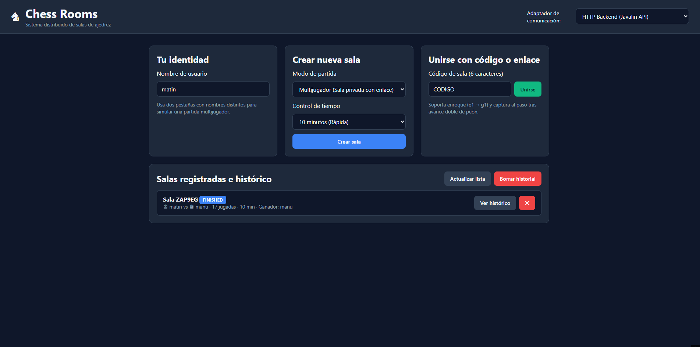
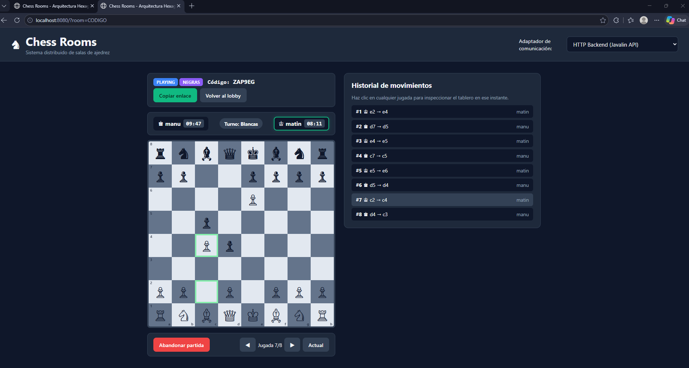
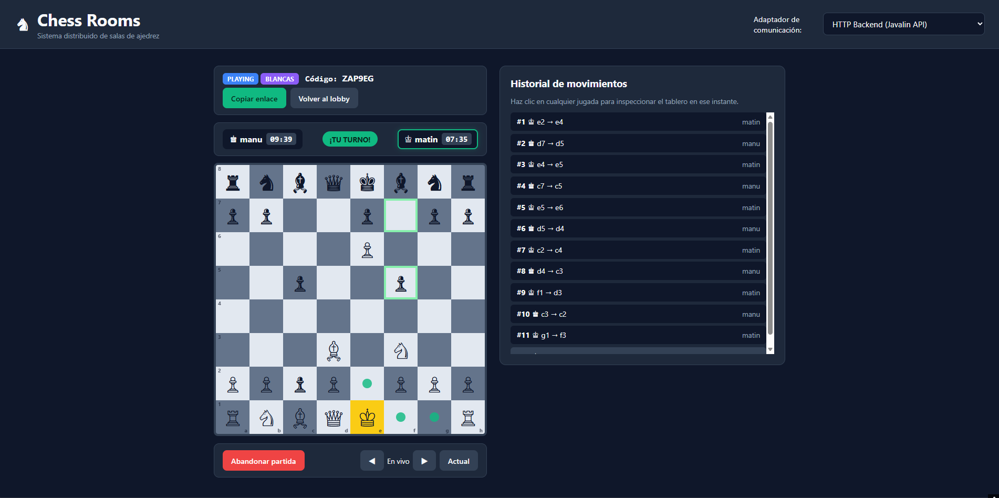

# ♞ Chess Rooms — Sistema de Salas para Jugar al Ajedrez

Aplicación web full-stack de ajedrez desarrollada en **Java 21** y **JavaScript moderno (ES6 Modules)** siguiendo los principios de **Arquitectura Hexagonal (Ports & Adapters)**. Permite crear salas privadas, conectar jugadores mediante código o enlace de invitación, disputar partidas multijugador en tiempo real, entrenar contra una inteligencia artificial propia (**ChessBot**), revisar la calidad de las jugadas al finalizar y consultar el histórico persistente.

🌐 **Despliegue en producción:** [https://chess-software.onrender.com](https://chess-software.onrender.com)

---

## 🎯 Objetivo de la entrega

Construir un sistema distribuido compuesto por dos aplicaciones coordinadas (**frontend** y **backend**) con contratos HTTP/JSON explícitos, separación estricta de responsabilidades entre dominio, casos de uso, puertos y adaptadores, persistencia de partidas en disco y capacidad de sustituir el adaptador de comunicación del frontend por un doble de prueba (*Mock*) sin modificar los casos de uso.

---

## 🏗️ Arquitectura de Sistemas

```text
+-----------------------------------+         HTTP / JSON (REST API)         +-----------------------------------+
|         FRONTEND (Web)            |  <---------------------------------->  |         BACKEND (Java 21)         |
|  HTML5 + CSS3 + JS ES6 Modules    |   GET/POST/DELETE /api/rooms/...       |      Servidor HTTP Javalin        |
|                                   |                                        |                                   |
|  [UI: BoardRenderer / main.js]    |                                        |  [ChessServer (Adaptador REST)]   |
|               |                   |                                        |               |                   |
|  [UseCases: RoomInteraction]      |                                        |  [UseCases: Create/Join/Move...]  |
|               |                   |                                        |               |                   |
|  [Port: ChessServicePort]         |                                        |  [Domain: ChessRoom / Board / IA] |
|        /             \            |                                        |               |                   |
| [HttpAdapter]   [MockAdapter]     |                                        |  [Port: RoomRepository]           |
+-----------------------------------+                                        +---------------|-------------------+
                                                                                             |
                                                                             +---------------v-------------------+
                                                                             |    PERSISTENCIA (Adaptador)       |
                                                                             |  FileRoomRepository (data/*.json) |
                                                                             +-----------------------------------+
```

---

## 🏛️ Arquitectura Hexagonal Interna

### Backend (`src/main/java/software/ulpgc/chess`)
* **Dominio (`architecture/domain`):** Entidades inmutables y reglas de negocio puras sin dependencias de frameworks externos: `Board`, `Piece`, `PieceType`, `Color`, `Square`, `File`, `Rank`, `Move`, `RoomStatus`, `ChessRoom`, `MovementValidator` (reglas FIDE), `BotMoveSelector` (motor IA Minimax con poda Alfa-Beta) y `GameReviewAnalyzer` (evaluación post-partida).
* **Puertos (`architecture/ports`):** Interfaces definidas por la aplicación: `RoomRepository` (persistencia) y `RoomCodeGenerator` (generación de códigos).
* **Casos de Uso (`architecture/usecases`):** Orquestación de las acciones del sistema: `CreateRoomUseCase`, `JoinRoomUseCase`, `MakeMoveUseCase`, `ResignGameUseCase`, `DrawGameUseCase`, `RequestRematchUseCase`, `ReviewGameUseCase`, `GetRoomUseCase`, `ListRoomsUseCase` y `DeleteRoomsUseCase`.
* **Infraestructura (`infrastructure`):**
  * *Adaptador de entrada:* `ChessServer` (expone la API REST con Javalin y sirve los ficheros estáticos).
  * *Adaptadores de salida:* `FileRoomRepository` (persistencia en JSON mediante Gson), `ChessGsonFactory` y `RandomRoomCodeGenerator`.
* **Composición (`Main.java`):** Punto de entrada que instancia los adaptadores y los inyecta en los casos de uso.

### Frontend (`src/main/resources/public`)
* **Interfaz de Usuario (`index.html`, `css/styles.css`, `js/main.js`, `js/ui/BoardRenderer.js`, `js/ui/SoundEffects.js`):** Adaptador de entrada que captura clics en el tablero y renderiza el estado sin construir peticiones `fetch` directamente.
* **Dominio ligero (`js/domain/ChessModels.js`):** Representación del tablero, cálculo de movimientos legales para resaltar casillas válidas, reconstrucción de jugadas en modo *replay* y conteo de material capturado.
* **Casos de Uso (`js/usecases/RoomInteractionUseCases.js`):** Coordina las acciones del usuario delegando siempre en `ChessServicePort`.
* **Puerto de Servicio (`js/ports/ChessServicePort.js`):** Contrato abstracto de comunicación con el backend.
* **Adaptadores de Comunicación (`js/adapters/`):**
  * `HttpChessAdapter.js`: Implementación real contra la API REST de Javalin.
  * `MockChessAdapter.js`: Doble de prueba en memoria seleccionable en vivo desde la barra superior para verificar el frontend de forma aislada.

---

## 📦 Modelo de Datos y Mecanismo de Conexión

* **Usuario:** Identificado por su nombre (`player`) al crear o unirse a una sala; determina su rol (`BLANCAS`, `NEGRAS` o `ESPECTADOR`).
* **Sala (`ChessRoom`):** Contiene `roomId` (UUID), `roomCode` (código público de 6 caracteres), `whitePlayer`, `blackPlayer`, `currentTurn`, `status` (`WAITING`, `PLAYING`, `FINISHED`), `winner`, `endReason`, `inCheck`, relojes (`timeLimitSeconds`, `whiteTimeRemainingMs`, `blackTimeRemainingMs`), `rematchRoomId` y `rematchRequestedBy`.
* **Tablero (`Board`):** Mapa inmutable de coordenadas algebraicas (`e2`, `e4`, etc.) a piezas (`WhitePawn`, `BlackKing`, etc.).
* **Movimiento (`Move`):** Registra `moveNumber`, `player`, `color`, `from`, `to`, `piece` y `timestamp`.
* **Conexión entre usuarios:** El creador obtiene un código de 6 caracteres (ej. `A7K9P2`) y un enlace directo (`/?room=A7K9P2`) con botón de copiado rápido, además de aparecer la sala en el listado público del lobby.

---

## 🔌 Contrato de Comunicación (API REST)

| Método | Ruta | Cuerpo / Parámetros | Respuesta |
| :--- | :--- | :--- | :--- |
| `GET` | `/api/rooms` | — | `200 OK`: Lista JSON de salas activas e histórico. |
| `POST` | `/api/rooms` | `{"player":"Matin","timeLimitSeconds":300,"vsBot":false,"color":"White"}` | `201 Created`: Objeto `ChessRoom` creado. |
| `POST` | `/api/rooms/join` | `{"roomCode":"A7K9P2","player":"Rival"}` | `200 OK`: Objeto `ChessRoom` en estado `PLAYING`. |
| `GET` | `/api/rooms/{roomId}` | `roomId` en ruta | `200 OK`: Estado actualizado de la sala (usado por *polling*). |
| `GET` | `/api/rooms/code/{roomCode}` | `roomCode` en ruta | `200 OK`: Sala asociada al código. |
| `POST` | `/api/rooms/{roomId}/moves` | `{"player":"Matin","from":"e2","to":"e4","promotion":null}` | `200 OK`: Tablero y movimientos actualizados. |
| `POST` | `/api/rooms/{roomId}/resign` | `{"player":"Matin"}` | `200 OK`: Sala finalizada (`RESIGNATION`). |
| `POST` | `/api/rooms/{roomId}/draw` | `{"player":"Matin"}` | `200 OK`: Sala finalizada (`DRAW_AGREED`). |
| `POST` | `/api/rooms/{roomId}/rematch` | `{"player":"Matin"}` | `200 OK`: Nueva sala de revancha con colores invertidos. |
| `GET` | `/api/rooms/{roomId}/review` | `roomId` en ruta | `200 OK`: Informe `GameReview` con precisión y etiquetas. |
| `DELETE` | `/api/rooms/{roomId}` | `roomId` en ruta | `200 OK`: `{"deleted":true}`. |
| `DELETE` | `/api/rooms` | — | `200 OK`: Borra todas las salas registradas. |

### Gestión de errores documentada
* `400 Bad Request`: Datos incompletos, jugador sin nombre o movimiento ilegal según las reglas FIDE (ej. mover fuera de turno o dejar al rey en jaque) → `{"error": "Descripción del error"}`.
* `404 Not Found`: Identificador o código de sala inexistente → `{"error": "Sala no encontrada..."}`.
* `409 Conflict`: Intentar unirse a una sala llena o mover en una partida ya finalizada → `{"error": "La partida no está activa"}`.

---

## ✨ Ideas Propias Incorporadas

1. **Validación FIDE completa + Entrenamiento contra IA (`ChessBot`):** Implementación de enroque, captura al paso, coronación con modal interactivo y un oponente IA basado en Minimax con poda Alfa-Beta para jugar en solitario.
2. **Revisión post-partida (*Game Review*):** Analizador que evalúa cada jugada tras finalizar el encuentro, calcula el porcentaje de precisión de cada jugador y clasifica los movimientos (`!`, `✓`, `?!`, `?`, `??`) indicando la mejor alternativa.
3. **Experiencia de juego mejorada:** Relojes con control de tiempo, marcador agrupado de piezas capturadas con ventaja material, revancha sincronizada con inversión de bandos, selector en vivo entre `HTTP Backend` y `Mock Local` y efectos de sonido sintetizados mediante Web Audio API.

---

## 📸 Capturas de Evidencia

### 1. Lobby, creación de salas y listado histórico



### 2. Tablero interactivo, indicadores de movimiento y relojes


### 3. Historial de movimientos y revisión de partida


---

## 🚀 Compilación, Ejecución Local y Verificación

### Requisitos y dependencias
* **JDK 21** (Eclipse Temurin o compatible).
* **Apache Maven 3.9+**.
* Dependencias gestionadas en `pom.xml`: `io.javalin:javalin:6.7.0`, `com.google.code.gson:gson:2.11.0`, `org.slf4j:slf4j-simple:2.0.16` y `org.junit.jupiter:junit-jupiter:5.11.4`.

### Configuración mediante variables de entorno
* `PORT`: Puerto HTTP del servidor (por defecto `8080`).
* `DATA_PATH`: Ruta del fichero JSON de persistencia (por defecto `data/rooms.json`).

### Ejecutar pruebas automatizadas (JUnit 5)
```bash
mvn test
```
Verifica reglas FIDE, inmutabilidad del tablero, jaque mate, coronación, analizador de revisión de partida, casos de error (sala inexistente, movimiento ilegal), sustitución del repositorio y persistencia tras reiniciar.

### Arrancar backend y frontend localmente
```bash
mvn compile exec:java -Dexec.mainClass="software.ulpgc.chess.Main"
```
El servidor backend arranca en `http://localhost:8080` y sirve automáticamente el cliente web frontend en `http://localhost:8080/index.html`.

---

## ⚠️ Límites Conocidos

* **Sincronización por polling HTTP:** El frontend consulta el estado de la sala periódicamente (`POLL_INTERVAL_MS`) en lugar de usar WebSockets persistentes, suficiente para partidas por turnos.
* **Repetición de posición y regla de 50 movimientos:** Se detectan jaque mate, ahogado y material insuficiente, pero no tablas automáticas por triple repetición ni regla de 50 jugadas.
* **Profundidad de búsqueda del Bot IA:** Limitada a profundidad controlada para garantizar respuestas inmediatas en entornos gratuitos de un solo núcleo como Render.